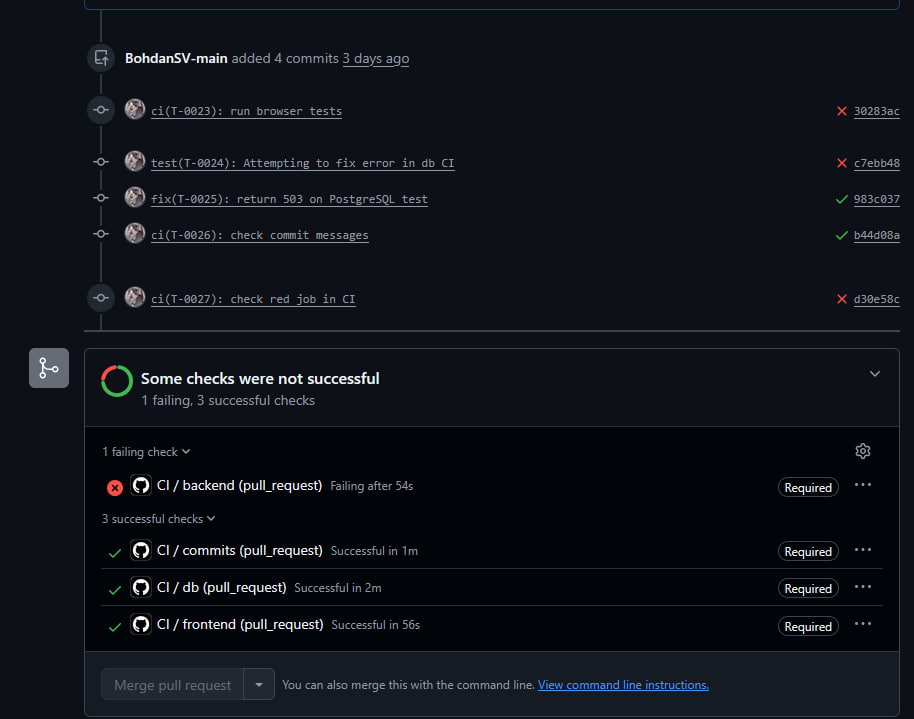

# ЛР4. Перевірка блокування мерджа

PR: [(https://github.com/BohdanSV-main/storage-controller/pull/7)]

| Перевірка | Результат | Доказ |
| --- | --- | --- |
| Додав `exit 1` до job-и `backend` | `backend` впав, Злиття в `main` заблоковано | [Червоний прогін](https://github.com/BohdanSV-main/storage-controller/actions/runs/45824527494/job/139925159206?pr=7) |
| Прибрав `exit 1` | Усі перевірки пройдені | [Зелений прогін](https://github.com/BohdanSV-main/storage-controller/actions/runs/45825641624/job/139928966008?pr=7) |

